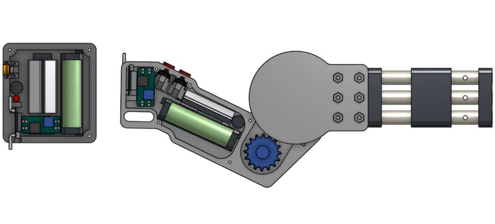
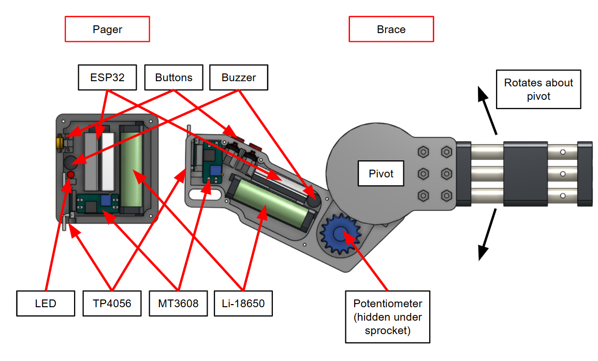
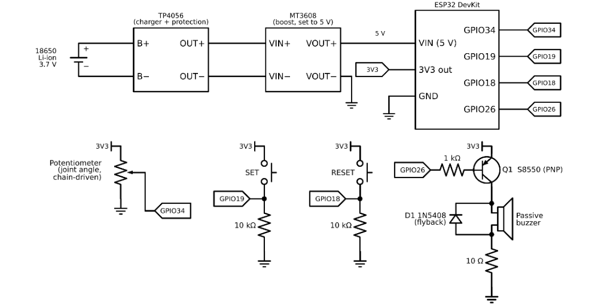
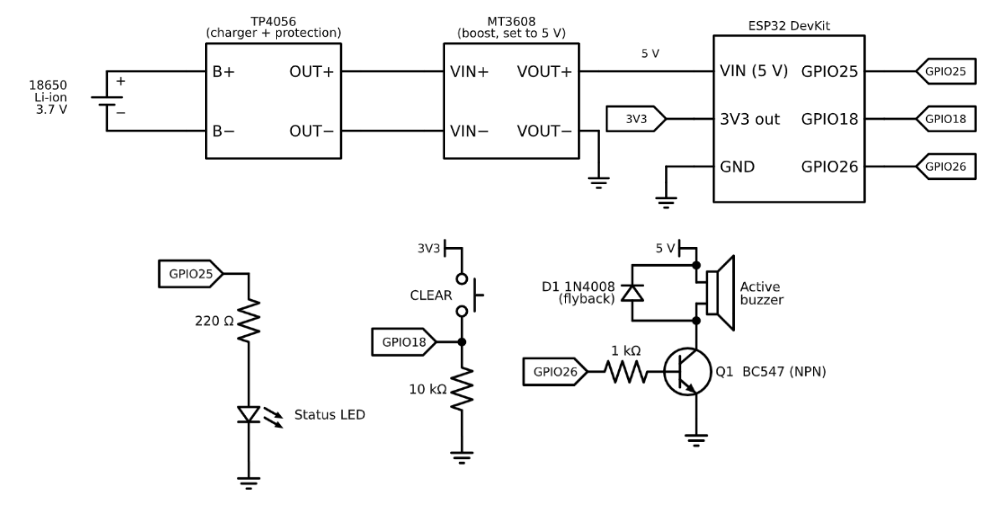

# RepBrace

**ECE198 Final Project**

RepBrace is an electronic rehabilitation brace designed to monitor joint range of motion (ROM) during rehabilitation exercises and provide feedback on repetition quality. The system combines an instrumented brace with a handheld pager to support consistent exercise performance.

## Project Overview

Rehabilitation exercises often require patients to complete repetitions within a prescribed range of motion. RepBrace aims to help patients recognize whether they have reached their target range and track exercise performance.

## Key Features

- Adjustable range-of-motion calibration using buttons.
- Joint rotation measurement using a potentiometer.
- Repetition tracking based on calibrated range of motion.
- Audible and visual feedback using buzzers and an LED.
- Compact, battery-powered brace and pager design.

## System Design

The system consists of two devices: the brace and the pager. Both incorporate ESP32 microcontrollers and rechargeable battery power systems.

### Brace

The brace rotates around a mechanical pivot. A sprocket coupled to a potentiometer allows joint motion to be measured electronically. Buttons allow the user to establish reference positions for range-of-motion tracking.

### Pager

The pager incorporates an ESP32, buttons, buzzer and LED in a compact enclosure for user interaction and feedback.

## Hardware Components

| Component | Purpose |
| --- | --- |
| ESP32 | Embedded processing and control |
| Potentiometer | Joint rotation measurement |
| Push buttons | User input and calibration |
| Buzzer | Audible feedback |
| LED | Visual feedback |
| TP4056 | Lithium-ion battery charging |
| MT3608 | DC-DC voltage step-up conversion |
| 18650 lithium-ion cell | Rechargeable power supply |

## Electrical Design

### Brace Circuit

The brace uses a chain-driven potentiometer connected to GPIO34, SET and RESET buttons on GPIO19 and GPIO18, and a passive buzzer controlled through an S8550 PNP transistor on GPIO26. A 3.7 V 18650 cell supplies power through a TP4056 charging and protection module and an MT3608 boost converter set to 5 V.

### Pager Circuit

The pager uses a status LED on GPIO25, a CLEAR button on GPIO18, and an active buzzer controlled through a BC547 NPN transistor on GPIO26. It uses the same battery charging and 5 V boost architecture as the brace.
